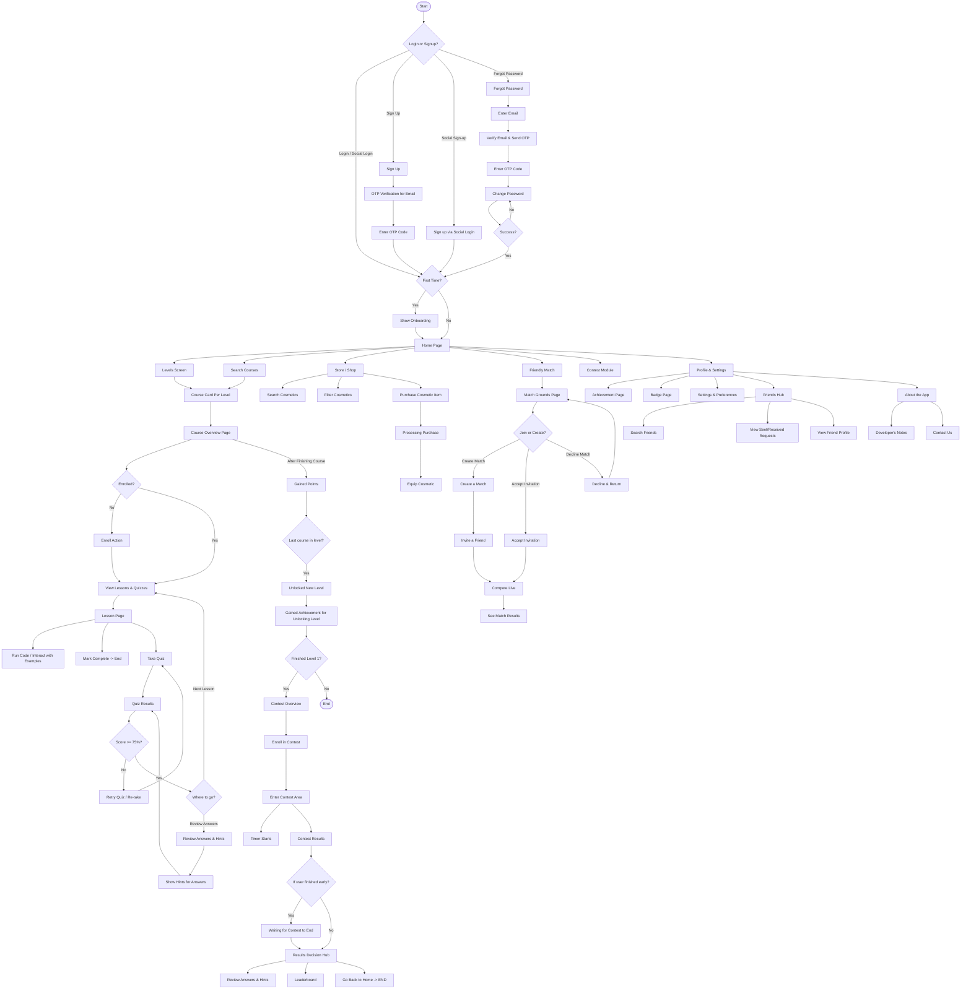

# SkillBit Rebirth - Comprehensive User Flow Documentation

This document outlines the complete user journey across authentication, courses, quizzes, contests, friendly matches, and the store/profile systems, derived from the project's master architectural diagram.

---

## 1. Authentication & Onboarding Flow
Handles initial registration, secure login, social sign-in, email verification, and password recovery.

